# Active Directory and PowerShell Automation Lab

## Overview

A Windows Server 2022 and Windows 11 lab built in VMware Workstation to practice Active Directory administration and automate user provisioning with PowerShell.

## Network Topology

- **Domain controller** — Windows Server 2022
- **Client** — Windows 11
- **Internal network** — `10.0.0.0/24`
- **Active Directory domain** — `vortex.local`

## Project Objectives

- Configure Active Directory Domain Services, DHCP, and NAT.
- Use PowerShell to create organizational units and import users from a CSV.
- Join a Windows 11 client to the domain and verify domain sign-in and DHCP address assignment.

## 1. Windows Server and Active Directory Setup

### Step 1. Plan the lab topology.

*The diagram shows the Windows Server 2022 VM, Windows 11 client, and separate internet and internal network adapters.*

### Step 2. Select the server roles in Server Manager.

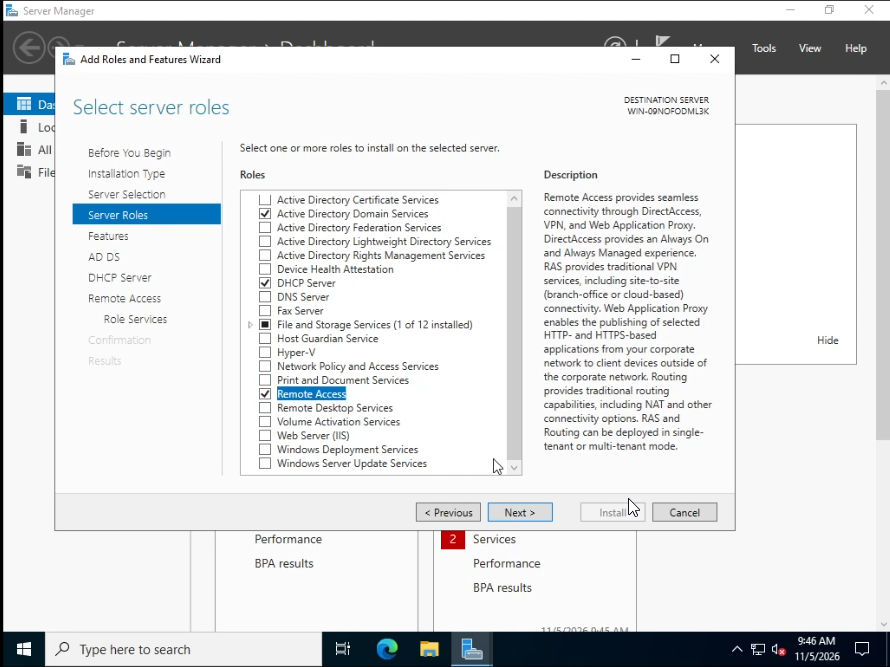

*Active Directory Domain Services, DHCP Server, and Remote Access are selected.*

### Step 3. Start a new forest in the AD DS Configuration Wizard.

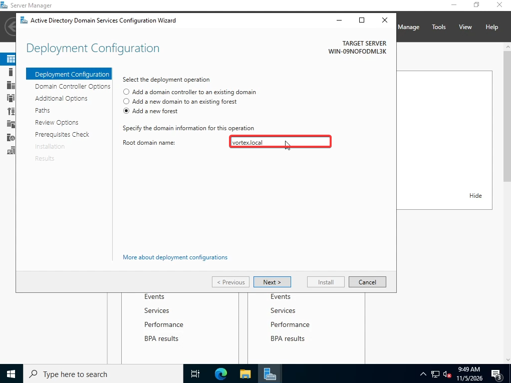

*The wizard shows vortex.local entered as the root domain.*

## 2. Network Adapter Setup

### Step 1. Configure the internet-facing adapter.

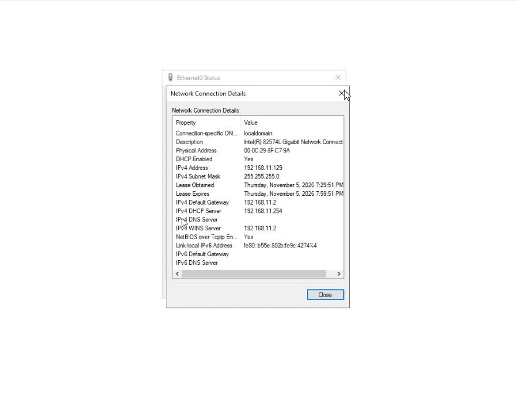

*The server's internet-facing adapter settings are shown.*

### Step 2. Test internet connectivity from the server.

*Successful ping replies confirm the server can reach the test destination.*

### Step 3. Create a VMware LAN segment for the internal network.

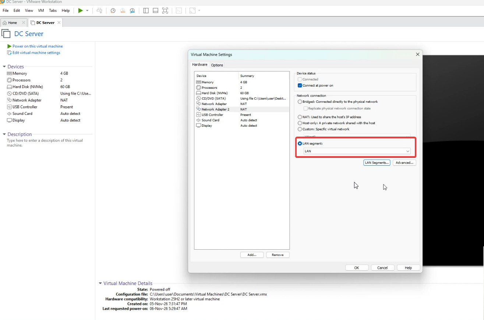

*The LAN segment appears in VMware's list.*

### Step 4. Configure the internal adapter.

*The adapter uses 10.0.0.1 on the internal subnet, with the gateway field left blank.*

### Step 5. Verify both adapters in Windows.

*Windows lists the Internal and Internet adapters separately.*

## 3. DHCP Server Setup

### Step 1. Create and name the DHCP scope.

*The wizard shows the name assigned to the new scope.*

### Step 2. Set the scope's address range.

*This screen defines the range available for client leases.*

### Step 3. Set the lease duration to three days.

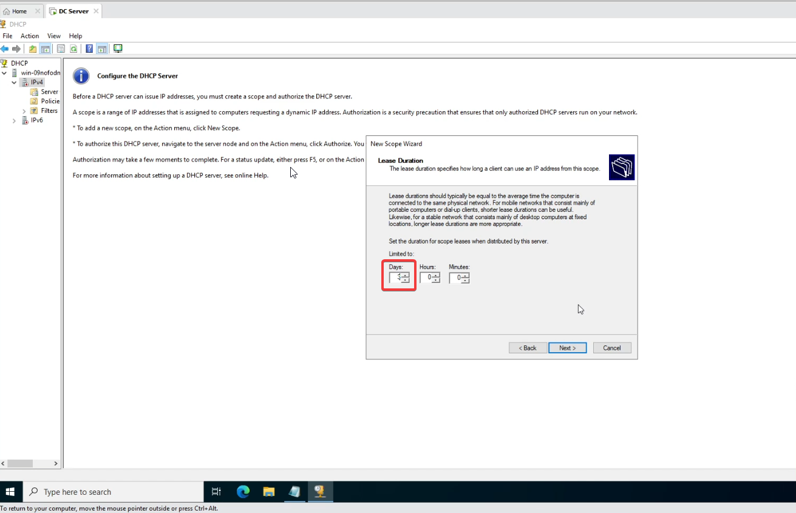

*The DHCP wizard shows a three-day lease duration.*

### Step 4. Set the router option for clients.

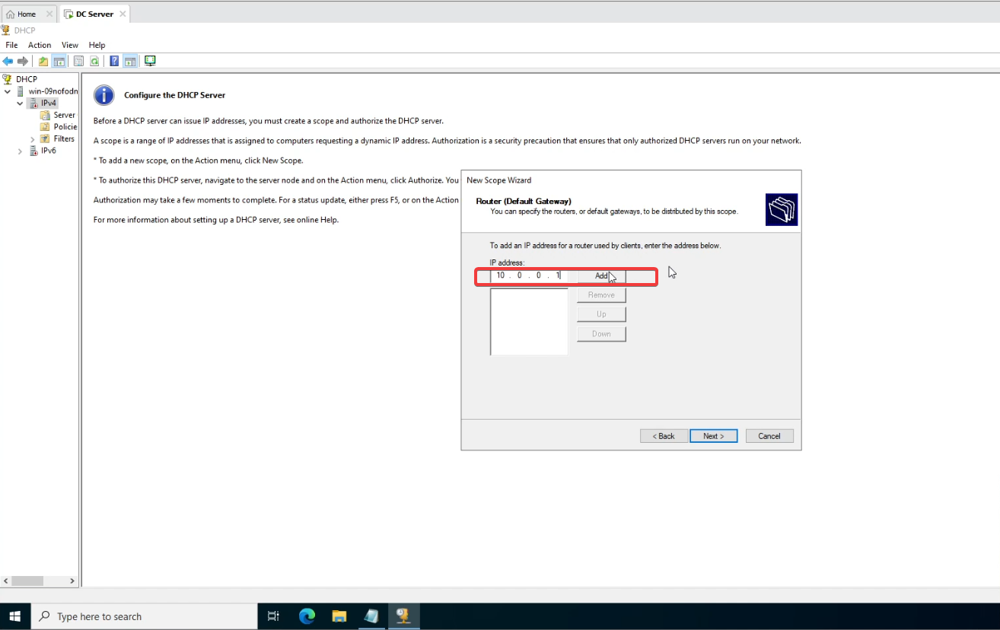

*Clients receive 10.0.0.1 as their default gateway.*

### Step 5. Authorize the DHCP server in Active Directory.

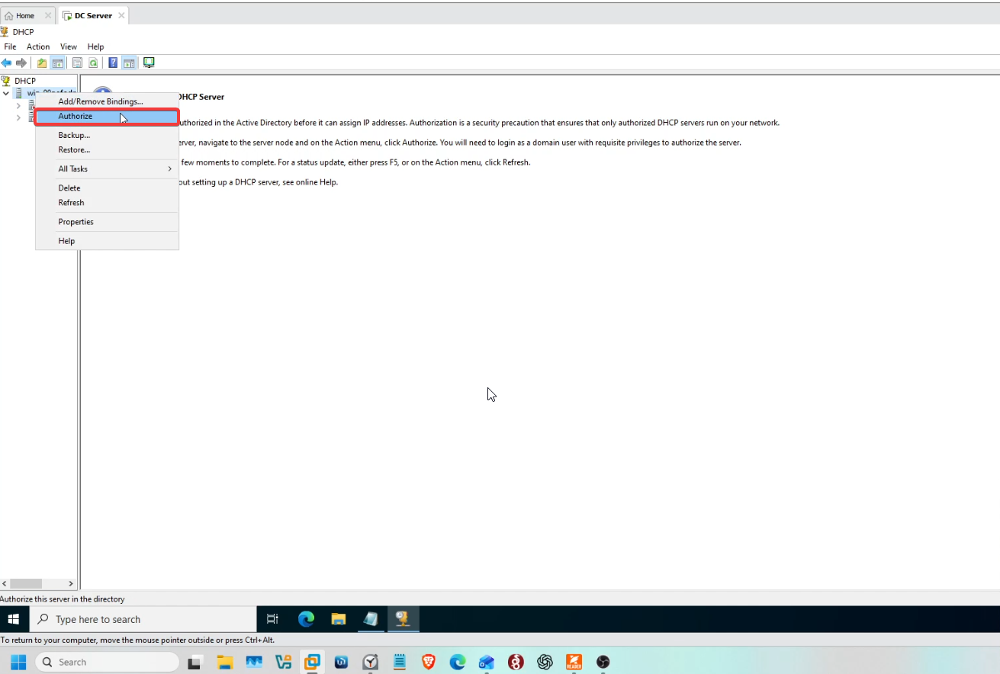

*The DHCP console shows the authorization step.*

## 4. Routing and NAT

### Step 1. Open the Routing and Remote Access setup wizard.

*The server is selected for Routing and Remote Access configuration.*

### Step 2. Choose Network Address Translation (NAT).

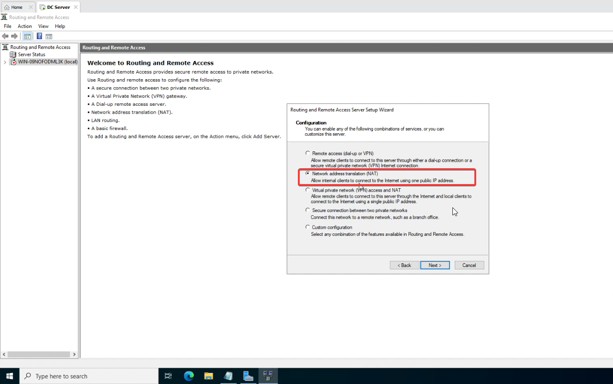

*The wizard shows NAT selected for the lab.*

### Step 3. Select the internet-facing adapter.

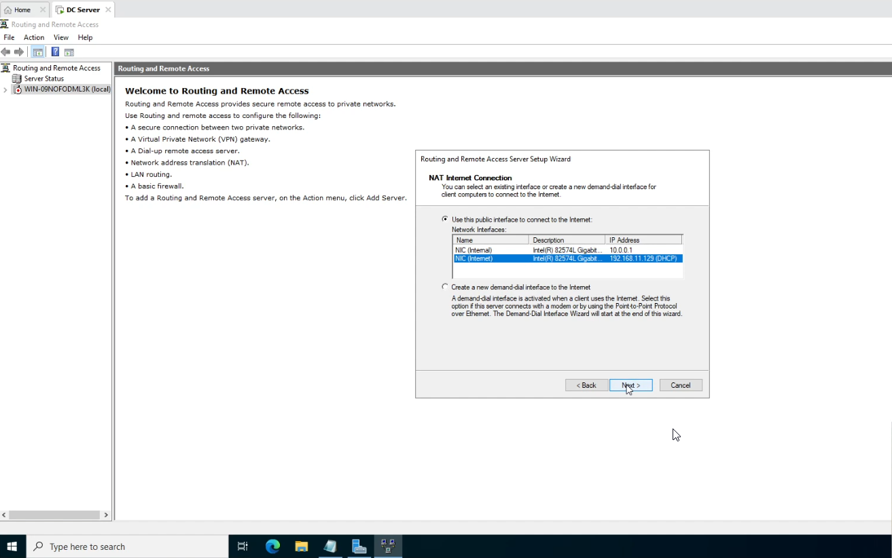

*The Internet adapter is selected as the external NAT interface.*

## 5. Bulk User Provisioning with PowerShell

### Step 1. Open and run the import script with the user CSV beside it.

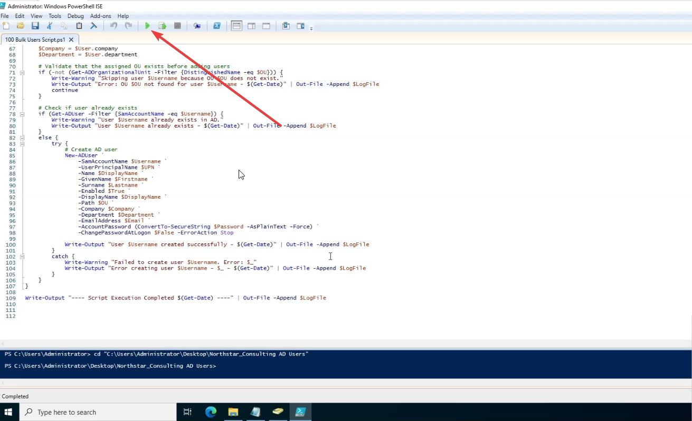

*PowerShell ISE shows the Run Script button used to start the import.*

### Step 2. Check the import log, then verify accounts in Active Directory Users and Computers.

*Active Directory Users and Computers shows the created organizational units and user accounts.*

## 6. Windows 11 Domain Join

### Step 1. Join the Windows 11 client to vortex.local.

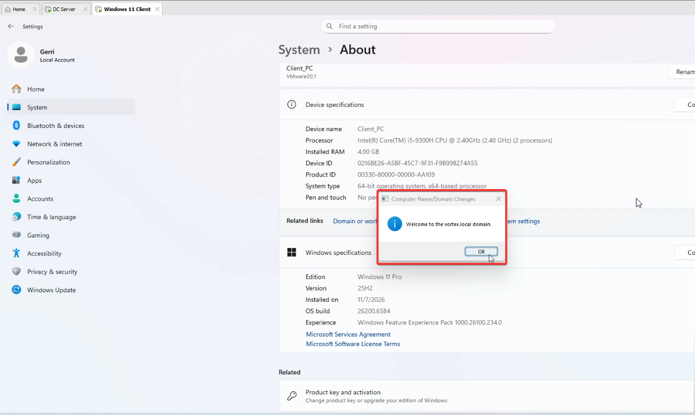

*Windows confirms the computer joined the domain.*

### Step 2. Sign in with a domain account.

*The Windows client shows a successful domain user sign-in.*

### Step 3. Verify the client received a DHCP lease.

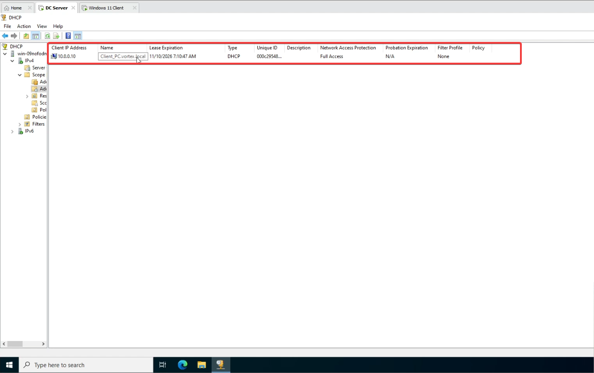

*The DHCP console lists the address leased to the client.*

## Reference

[TechGneek's Active Directory and PowerShell Automation Lab](https://github.com/techgneek/Active-Directory-and-Powershell-Automation) provided the README structure.

